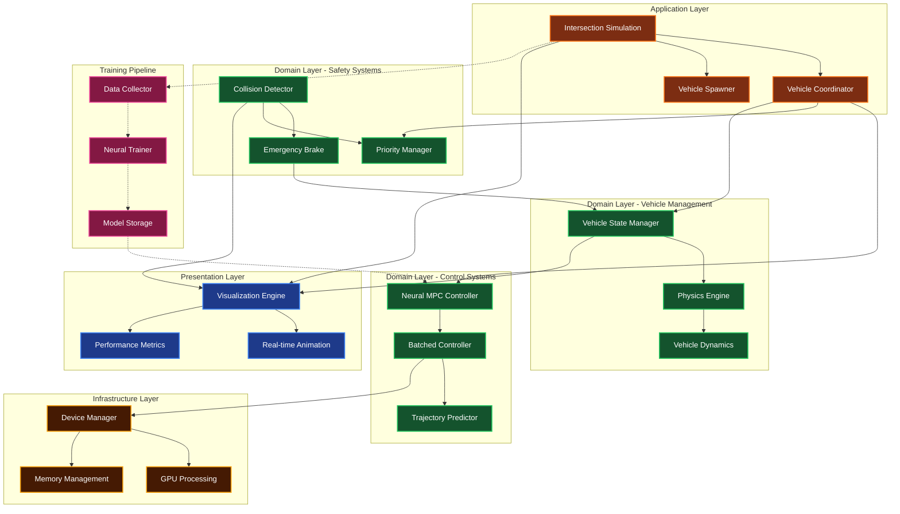

# Autonomous Vehicle Traffic Simulation

A high-performance traffic intersection simulation that tests the hypothesis: **Can autonomous vehicles eliminate traffic lights through coordination?**

## Overview

This simulation implements a modern autonomous vehicle control system using neural Model Predictive Control (MPC) with GPU acceleration. Vehicles coordinate through priority-based decision making to navigate intersections without traditional traffic lights.

## Quick start

```bash
pip install torch numpy matplotlib
python proto.py           # run the intersection simulation
python proto.py --train   # train the neural MPC controller
```

Training saves `trained_neural_mpc.pth`; `python test_model.py` checks that it loads.

## How it works

The simulation uses a priority-based coordination system where:
1. Vehicles approaching the intersection are assigned priorities
2. Neural MPC predicts optimal trajectories while avoiding collisions
3. GPU-accelerated batch processing handles multiple vehicles simultaneously
4. Real-time collision detection ensures safety
5. Adaptive vehicle spawning maintains traffic density

## Features

- **Predictive Collision Avoidance**: Neural MPC controller with 15-step horizon
- **Priority-Based Coordination**: Vehicles negotiate intersection traversal through priority assignment
- **GPU Acceleration**: CUDA-optimized batched processing with workload-aware device selection
- **Real-time Visualization**: Matplotlib-based animation with collision detection
- **Training Pipeline**: Data collection and neural network training capabilities
- **Vectorized Operations**: High-performance tensor operations for vehicle dynamics

## Two simulations

- **`proto.py`**: the neural MPC simulation described in this README, with Matplotlib
  animation.
- **`autocar.py`**: a larger experimental version using GRPO (Group Relative Policy
  Optimization) reinforcement learning, graph neural networks, learned vehicle-to-vehicle
  communication and transformer networks, with pygame 2D or Panda3D 3D visualization. Run
  `python autocar.py` and pick a mode from the menu: train (with or without visualization),
  or run the 2D or 3D simulation with a trained model. It also needs `pygame` and `rich`;
  `panda3d` is optional.

## Testing Hypothesis

The simulation tests whether autonomous vehicles can coordinate without traffic lights by:
- Eliminating fixed traffic signals
- Using dynamic priority assignment
- Implementing predictive collision avoidance
- Measuring traffic flow efficiency and safety metrics

## Core Components

### Classes

- **`VehicleState`**: Optimized vehicle representation with position, velocity, and priority
- **`NeuralMPCController`**: Neural network-based predictive controller
- **`BatchedMPCController`**: GPU-optimized batched control processing
- **`IntersectionSimulation`**: Main simulation engine with real-time collision detection
- **`TrainingDataCollector`**: Data collection system for neural network training
- **`NeuralMPCTrainer`**: Training pipeline for the MPC controller

### Key Functions

- **`create_scenario()`**: Creates the main intersection simulation scenario
- **`create_training_scenario()`**: Sets up simulation for training data collection
- **`train_neural_mpc()`**: Trains the neural MPC controller
- **`pick_device()`**: Workload-aware GPU/CPU device selection

## Architecture diagram



## Training

The system includes a complete training pipeline:
- Collects trajectory data from simulation runs
- Trains neural networks to predict optimal control actions
- Uses teacher-student learning with traditional MPC as ground truth
- Supports both CPU and GPU training

## Safety Features

- **Multi-layer collision detection**: Visual, continuous, and predicted collision checks
- **Safety margins**: Configurable collision avoidance parameters
- **Emergency braking**: Automatic deceleration when collisions are imminent
- **Priority system**: Prevents deadlocks at intersection crossings

## Performance Optimizations

- **Workload-aware device selection**: Automatically chooses GPU/CPU based on batch size
- **Pre-rotated shape templates**: Cached vehicle visualizations for performance
- **Vectorized dynamics**: Batch processing of vehicle trajectories
- **CUDA stream management**: Optimized GPU memory transfers
- **Adaptive spawning**: Dynamic vehicle population control

## Simulation Parameters

- **Max Vehicles**: 16 (configurable)
- **Prediction Horizon**: 15 steps
- **Time Step**: 0.1 seconds
- **Intersection Size**: 20x20 units
- **Lane Width**: 8.0 units
- **Vehicle Length/Width**: 4.5m × 2.0m

## Requirements

- Python 3.8+
- PyTorch (with CUDA support recommended)
- NumPy
- Matplotlib
- CUDA-capable GPU (optional, automatic fallback to CPU)
